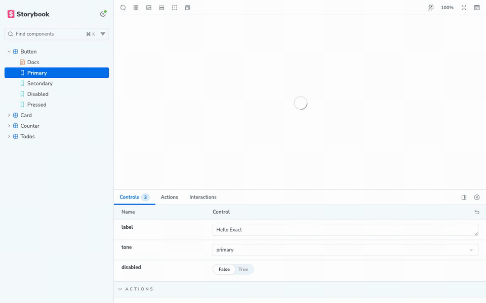
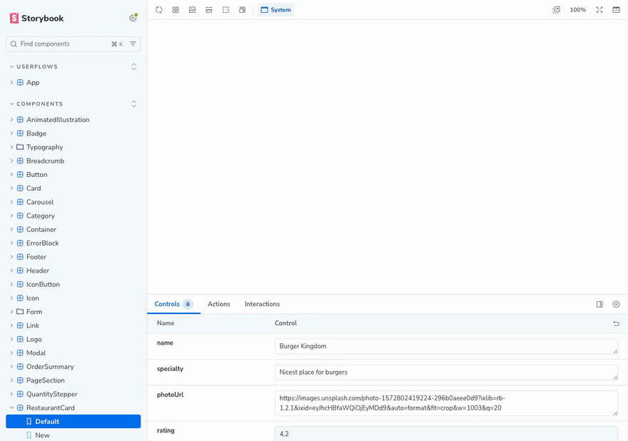

# storybook-framework-exact

A community [Storybook](https://storybook.js.org) framework for [Exact](https://github.com/expo/exact), Expo's cross-platform runtime. It lets you write stories for components written in Contract (`.contract` files) and see them on Exact's web target, with Controls, Actions, play functions, docs and hot reload.

[](docs/demo.mp4)

```ts
// button.stories.ts
import type { Meta, StoryObj } from 'storybook-framework-exact';

import { Button } from './button.contract';

const meta = {
  component: Button,
  args: { label: 'Hello Exact', tone: 'primary', disabled: false },
} satisfies Meta<typeof Button>;
export default meta;

export const Primary: StoryObj<typeof Button> = {};
export const Secondary: StoryObj<typeof Button> = { args: { tone: 'secondary' } };
```

For something larger, [`examples/mealdrop`](examples/mealdrop) is Storybook's Mealdrop demo ported to Contract: a design system, pages, and the whole app with its routes.

[](docs/mealdrop.mp4)

> [!WARNING]
> Experimental. Exact is pre-1.0, changes daily and has no published package, so this framework builds one pinned commit of it from source and relies on some of its internals. It is not affiliated with Expo.

## Requirements

- Node 20.19 or newer, and Storybook 10 with Vite.
- For typed `.contract` imports, TypeScript 7.1, which is in beta (`npm install -D typescript@beta`). An older TypeScript works with generated declaration files: see [Types](#types).
- What Exact itself needs to build: [Rust](https://rustup.rs) (through rustup, which installs the toolchain Exact pins) and `git`.
- macOS or Linux. Windows is untested.

Exact also needs a specific Bun. If the `bun` on your PATH is older than the one Exact pins, the framework downloads the pinned one into its cache and leaves yours alone.

## Install

Until it is on npm, install it from GitHub:

```sh
npm install -D github:dannyhw/storybook-framework-exact storybook vite
```

```ts
// .storybook/main.ts
import type { StorybookConfig } from 'storybook-framework-exact';

const config: StorybookConfig = {
  framework: 'storybook-framework-exact',
  stories: ['../app/**/*.stories.ts'],
};

export default config;
```

For typed `.contract` imports, name the framework as the content mapper of `.contract` files in `tsconfig.json`, and let `tsc` run it (see [Types](#types)):

```json
{ "contentMappers": [{ "package": "storybook-framework-exact", "extensions": [".contract"] }] }
```

```sh
tsc --runExternalCode
```

### Getting Exact

The first `storybook dev` or `storybook build` fetches Exact from GitHub at the commit this version was tested against, installs its JavaScript dependencies and builds its Contract compiler with Cargo. The compiler is built optimised (Exact's `host-dev` profile), because a story is built when you open it: it compiles a component in a few milliseconds where a debug build takes a few hundred. That happens once per machine and took a minute or two on an M-series Mac with a warm Cargo cache; a cold one takes a few minutes. Everything goes into `~/.cache/storybook-framework-exact` (about 2 GB, most of it Cargo's build output), never into your project.

To do it ahead of time, in CI for example:

```sh
npx storybook-exact setup
```

To use an Exact checkout you already have, set `exactRoot` (or the `EXACT_ROOT` environment variable). It is used as it is, with the compilers it last built (`cargo build --profile host-dev -p exact-web-js -p contract` for the fast ones); a checkout far from the pinned commit may not work.

```ts
framework: { name: 'storybook-framework-exact', options: { exactRoot: '../exact' } },
```

| Option | Environment | What it does |
|---|---|---|
| `exactRoot` | `EXACT_ROOT` | Use this Exact checkout instead of the managed one |
| `exactCommit` | `EXACT_COMMIT` | Fetch another commit of `expo/exact` for the managed checkout |
| `typegen` | | Write `<name>.d.contract.ts` beside imported Contract files, for a TypeScript older than 7.1 (default `false`) |
| | `STORYBOOK_EXACT_CACHE` | Where the managed checkout and Bun are kept |
| | `BUN` | The Bun to run Exact's build scripts with |
| | `STORYBOOK_EXACT_WHOLE_BUILDS` | Set to `1` to run Exact's whole web build for every component (see [How it works](#how-it-works)) |

## Writing stories

### A component's props are its args

Import a component from its `.contract` file and set it as `component`. Its `props` become args, with a control for each: text for `string`, a number field for `number`, a toggle for `bool`, a select for `enum<"a", "b">`, a colour picker for `color`, and an object editor for shapes and lists.

```contract
component Button
  props
    label: string
    tone: enum<"primary", "secondary">
    disabled: bool
    press: action
  view
    button press=press disabled=disabled
      text label
```

Contract props have no defaults and every one is required. An arg a story leaves out gets a stand-in for its type (`""`, `0`, `false`, an enum's first member, an empty list, `none`).

Changing an arg does not rebuild or remount the component: the running app is asked for its args again, so state the component owns (a counter's count, a field's draft) survives the change.

### Action props

A prop of type `action` shows in the Actions panel when the component calls it, with the values it passed. That holds however the component uses it: called from one of its own actions (`changed(count)`), or bound to an event (`press=pick(item)`, `change=set`). Give it a spy to assert on it in a play function:

```ts
import { expect, fn } from 'storybook/test';

export const Pressed: StoryObj<typeof Button> = {
  args: { press: fn() },
  play: async ({ canvas, args, userEvent }) => {
    await userEvent.click(await canvas.findByRole('button'));
    await expect(args.press).toHaveBeenCalledOnce();
  },
};
```

### Components that own data

In Contract only an app's root component may declare a `resource`, `mutation` or `task`; everything else takes data through props. A story for a root component answers its sources, where the app's `app.ts` or Rust module would:

```ts
import { Todos } from './todos.contract';

export const Seeded: StoryObj<typeof Todos> = {
  parameters: {
    exact: {
      sources: {
        todos: () => [{ id: '1', title: 'Buy milk', done: false }],
        addTodo: (title: string) => ({ count: 2 }),
      },
    },
  },
};
```

A source gets the arguments the component passed and returns plain values (objects for shapes, arrays for lists, `null` for `none`), or a promise of them. Its answer is checked against the shape the component declared, and an answer that does not fit is refused with the field's name (`loadProfile.name should be a string, and is 42`). A root component must be the first component in its file.

A file with `routes` is a root too, and its first component is shown as the app. It starts at `/`, or at the location its story gives:

```ts
export const Checkout = { parameters: { exact: { location: '/checkout' } } };
```

The app navigates as it does on a page of its own, and the browser's Back and Forward step through its visits. The canvas keeps Storybook's address throughout, so a reload shows the story again, from its start.

Exact's navigation stack keeps every visit of the stack in the document, the ones beneath hidden and inert. A play function's `getByText` finds those too, so for an app that shows one page at a time, draw only the top visit (`for e in [top(nav)] key=e.id`), as [`examples/mealdrop`](examples/mealdrop/app/app.contract) does.

A root that fills its window (`height="100%"`) fills the canvas.

### Injected values and slots

A value a component takes with `inject` is an arg too; the story provides it.

A component with a `slot` is shown with a line of placeholder text as its children. To show it with real children, write a small Contract component that fills the slot and write the story for that one.

### Libraries

A package that exports Contract (`"exports": { ".": "./index.contract" }` in its `package.json`) is a library, and a story for one of its components can sit beside it. The component is built as the library's users get it, by the package's name, which is what gives it the tokens in the package's `.tamber`. So a story can only show a component the package exports.

```ts
// packages/chips/chip.stories.ts
import { Chip } from './chip.contract';

export default { component: Chip, args: { label: 'Dark mode', selected: false } };
export const Off = {};
```

### Images and fonts

Files in the app's `assets/` folder are served to the canvas and included in a static build, so `image "assets/photo.png"` and `font "Brand" = "assets/brand.ttf"` work as they do in the app. When two apps in one Storybook have an asset of the same name, the first one loaded wins.

### Design tokens

The app's design applies to every story: the `.tamber` file its `app.json` names with `"tamber"`, or else the `app.tamber` beside it. So `color="text.primary"` or `gap="space.md"` means in a story what it means in the app. A library's components get the tokens of the library's own `.tamber`.

### Colour scheme

Exact's tokens follow the document's `color-scheme`, which is what its own `setScheme` sets. To choose the scheme from Storybook's toolbar, set it from a decorator:

```ts
// .storybook/preview.ts
import type { Decorator, Preview } from 'storybook-framework-exact';

const withScheme: Decorator = (story, { globals }) => {
  const { scheme } = globals;
  document.documentElement.style.colorScheme = scheme === 'light' || scheme === 'dark' ? scheme : '';
  return story();
};

const preview: Preview = {
  globalTypes: {
    scheme: {
      toolbar: {
        title: 'Scheme',
        items: [
          { value: 'system', title: 'System', icon: 'browser' },
          { value: 'light', title: 'Light', icon: 'sun' },
          { value: 'dark', title: 'Dark', icon: 'moon' },
        ],
        dynamicTitle: true,
      },
    },
  },
  initialGlobals: { scheme: 'system' },
  decorators: [withScheme],
};
export default preview;
```

### Types

`import { Button } from './button.contract'` is typed: the file's components with their args, and its shapes, so `Meta<typeof Button>` checks a story's args and a source mock can be typed with the component's own shapes. A shape one Contract file takes from another (`use Restaurant from "./data/shapes.contract"`) is that file's shape.

TypeScript reads the Contract file itself, through the framework, which is a [content mapper](https://devblogs.microsoft.com/typescript/announcing-typescript-7-1-beta/) for `.contract` files. That needs TypeScript 7.1 (in beta) and the `contentMappers` entry in `tsconfig.json` shown under [Install](#install). Nothing is written beside your sources, and nothing can be stale.

- **On the command line**, a content mapper is code TypeScript runs, so TypeScript asks to be told it may: `tsc --runExternalCode`. Without the flag `tsc` stops with `TS18068`.
- **In an editor** that uses TypeScript 7.1, the workspace must be trusted and content mappers allowed (in VS Code, the `js/ts.contentMappers.enabled` setting turns them off). "Go to Definition" on a story's arg, or on the imported component, then opens the prop or the component in the Contract file, and a `use` of a file that is not there is underlined in the Contract file.

This part is an experiment on a beta: the mapper speaks version 1 of a protocol TypeScript has not yet documented, and has been run with `tsc` and TypeScript's language server, not yet in VS Code itself.

#### An older TypeScript

Before 7.1, TypeScript reads a `<name>.d.contract.ts` beside each Contract file instead, with `"allowArbitraryExtensions": true` under `compilerOptions`. The framework writes one for each Contract file a story imports when its `typegen` option is on, and for every file under a directory with:

```sh
npx storybook-exact types app
```

Commit these files or ignore them (`*.d.contract.ts`). In them a shape taken from another file is `unknown`.

## How it works

In short, below. The long version, with diagrams and answers to the usual questions, is at [dannyhw.github.io/storybook-framework-exact](https://dannyhw.github.io/storybook-framework-exact/).

Exact compiles a whole app, and its web runtime mounts one app per page. So a story is a small app:

1. Importing a `.contract` file gives a description of each component, read from its source.
2. When a story first renders, the component is built. A component with props gets a generated root that places it, reads its value props from one `resource` and sends each action prop's call to a `mutation`; a root component is built as it is. What each action prop is given is not in the source, so the generated root is compiled until Exact's compiler has said. Exact's compiler compiles the result.
3. The preview imports the build into the canvas and answers Exact's data seam: the args resource from the story's args, the action mutations to the story's handlers, and any other source from `parameters.exact.sources`.

### What you wait for

A component is built when you open one of its stories, and again after an edit, so the build is kept short:

- **Exact's whole web build runs once per kind of component.** Around the app's own modules that build places about 130 runtime modules, the same for every component that uses the same features. The first component pays for them (about a second); every other is the compiler alone and a bundle: about 35 ms in the example here, and around 100 ms for a component of a 50-file app. The result is byte for byte what the whole build gives, and a test holds it to that. `STORYBOOK_EXACT_WHOLE_BUILDS=1` turns the reuse off.
- **Builds are kept on disk**, under `node_modules/.cache`, so a server that starts again builds only what changed since.
- **An edit rebuilds the stories you have open before the page asks**, the one on screen first, so a hot update shows in well under a second.
- **Switching between stories that are built** takes about 50 ms: the stylesheet, a fresh copy of the runtime (10 to 25 ms) and the app's start. Storybook shows its spinner after 100 ms, so there is none.

Builds happen in a copy of your app's Contract sources and assets kept under `node_modules/.cache`, so nothing is generated into your source tree, and your app's own `app.ts`, Rust module and native modules are not part of a story. A library is not copied: the build is an empty app that depends on it.

## Limitations

- **One story per document.** Exact's runtime cannot be unmounted, and it mounts into a fixed element. Docs pages therefore show each story in its own iframe (`docs.story.inline` is `false` by default; turning it on breaks pages with more than one story). Switching stories loads a fresh copy of the runtime, and the previous copy is not disposed until the preview reloads.
- **Docs pages.** A story's iframe has Storybook's default height (100px); set `parameters.docs.story.height` for a taller component. The controls on a docs page do not reach the stories, and "Show code" is empty.
- **Decorators cannot wrap markup.** A story renders an Exact app, not DOM you return. A decorator can change args and parameters; to wrap a component, wrap it in Contract.
- **A component that needs a parent or children.** A row made for a `list`, or a card whose slot is its content, is shown on its own, with a line of placeholder text in its slot. Write a small Contract component that places it as you want it seen, and write the story for that.
- **`option<T>` in Controls.** A control cannot set an optional value back to `none`; reset the controls, or give the story `null`.
- **Dark mode.** Exact follows the browser's colour scheme. Storybook's background tool changes the canvas's background, not the scheme; a toolbar item of your own can set the scheme (see [Colour scheme](#colour-scheme)).
- **A component that does not compile fails a static build**, if a story imports it. `storybook dev` shows the error in that component's stories and runs the rest. A component no story imports is left out of a static build when it cannot be built on its own (a row made for a list, a second component in a file with `routes`), and the build says so.
- **Native modules, the app's TypeScript and Rust data modules, and routes into other apps** are not part of a story.
- **Web only.** Stories show Exact's web target, not its native hosts.
- **Exact's version is pinned.** Moving to a newer Exact means a new release of this framework.

## Developing this repository

```sh
npm install
npm run build            # tsc into dist/
npm test                 # unit tests
npm run example          # the example Storybook, on port 6116
npm run e2e              # browser tests against the example
```

There are two examples, each an npm workspace that uses the framework from the repository root:

- `examples/basic`: an app (`app/`) and a small library (`lib/chips`), small enough to read in a sitting. The browser tests run against it.
- [`examples/mealdrop`](examples/mealdrop): a port of Storybook's Mealdrop to Contract: a design system with tokens, pages, and a whole app with routes and a cart (`npm run example:mealdrop`, port 6117).

`npm run sweep -- --url <a running Storybook>` (or `--dir <a static build>`) opens every story on its own and says whether it rendered and its play function passed; CI runs it over the Mealdrop example's static build.

The walkthroughs at the top of this page are recorded from the running examples, so they show what the code does today. To record them again, with `npm run example` and `npm run example:mealdrop` running:

```sh
npx playwright-core install ffmpeg   # once
node scripts/record-demo.mjs         # writes docs/demo.mp4 and docs/demo.gif
node scripts/record-mealdrop.mjs     # writes docs/mealdrop.mp4 and docs/mealdrop.gif
```

## License

MIT
