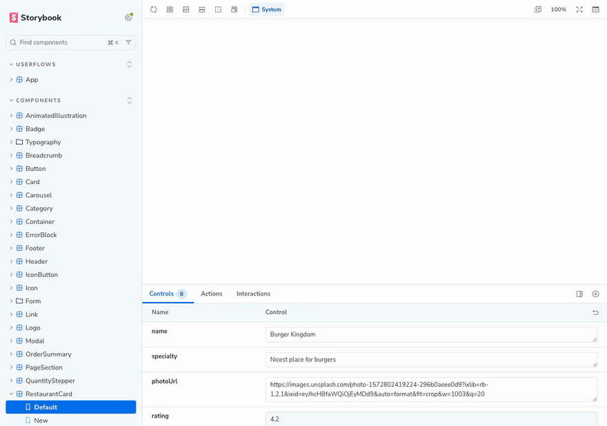

# Mealdrop, in Contract

A port of [Mealdrop](https://github.com/storybookjs/mealdrop), Storybook's example food-delivery app, to Exact's Contract language: its design system, its pages, and the whole app with its routes, each with the stories and play functions the original has.

[](../../docs/mealdrop.mp4)

```sh
npm run example:mealdrop     # from the repository root: Storybook on port 6117
```

The folder is an Exact app as well: `app/app.ts` answers the app's sources from the same in-memory store the stories use, and Exact's own web build builds it and runs it (`bun host/web-js/build.mjs examples/mealdrop/app --out <a directory>` from an Exact checkout).

## What is where

| Folder | What |
|---|---|
| `app/app.tamber` | The design: Droppy's colours, spacing and radii as tokens, light and dark. |
| `app/components/` | The design system (button, input, modal, sidebar, …) and the app's own parts (header, cart, restaurant card). |
| `app/templates/` | The page template: header, page, footer and the cart. |
| `app/pages/` | The pages, each a component that takes its data as props and gives what the reader does back as action props. |
| `app/app.contract` | The app: the routes, the restaurants and the cart as resources, and the page for each route. `app.contract.d.ts` is what `contract types` writes for `app.ts`. |
| `app/data/` | The shapes the components share, the stub restaurants, and the in-memory store that answers the app's sources in a story. |

## What a story shows here

- **A component** (`Components/…`): its props are the story's args, its action props are spies a play function checks.
- **A page** (`Pages/…`): the same, with a restaurant or a cart as args and `status` for its loading, missing and failing states.
- **The app** (`UserFlows/App`): the whole thing, starting at `/` or at `parameters.exact.location`, its sources answered by a store of the story's own. The play functions walk from the home page to a confirmed order; `DemoMode` does it at a pace to watch.
- **The scheme**: the toolbar's Scheme item switches light and dark (`.storybook/preview.ts`).
- **The phone layout**: Contract has no media queries; a page takes `compact`, and a decorator sets it from the canvas's width, so the viewport tool shows the phone layout.

## Checking every story

```sh
npm run sweep -- --url http://localhost:6117            # each story's render and play function
npm run sweep -- --url http://localhost:6117 --dark
npm run sweep -- --url http://localhost:6117 --width 390 --height 800 --filter pages-
```

## Credits and licences

- **Mealdrop** is by Yann Braga and the Storybook team, and has no licence file. This is a rewrite in another language of what its stories show: none of its code is here, and none of its artwork (logo, illustrations, backgrounds, animations); the drawings in this folder are stand-ins made for this port. Its stub data is here (`app/data/stub.ts`: the restaurants, their menus and prices, and the addresses of their photographs).
- **The design** (tokens and icons) is ported from [Droppy](https://github.com/yannbf/droppy-ds), MIT, © Yann Braga: `LICENSE-droppy.txt`.
- **The fonts**, Montserrat and Hind, are under the SIL Open Font License: `app/assets/fonts/OFL-*.txt`.
- **The photographs** are loaded from Unsplash and Pexels by the addresses Mealdrop's stub data uses; none is in the repository.
